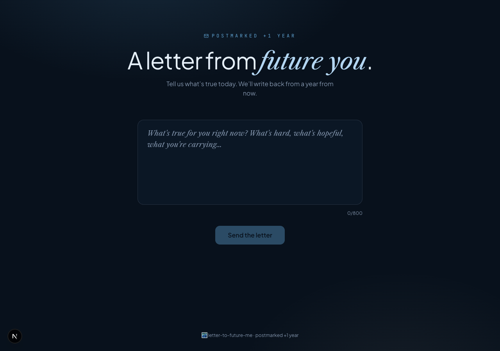

# 🌃 Letter to Future Me

> A letter from future you.

Tell us what&rsquo;s true today — what&rsquo;s hard, what&rsquo;s hopeful, what you&rsquo;re carrying. AI writes back a short, gentle letter dated one year from now. Downloadable as a postmarked envelope card on warm paper under a starry night.

Your letter is kept in the browser, so a refresh never loses it — press “New letter” when you&rsquo;re ready to start over.

## Stack

- Next.js 15 · App Router · TypeScript
- Tailwind CSS v4 (`@theme`)
- OpenAI `gpt-4o`
- `html-to-image`
- Framer Motion · lucide-react
- Libre Caslon Text · Plus Jakarta Sans · JetBrains Mono

## Setup

```bash
pnpm install
cp .env.example .env.local
# add your OPENAI_API_KEY
pnpm dev
```

Open http://localhost:3000.

## License

MIT



## Terms & Disclaimer

By using this project you agree to the following.

- **No warranty.** This software is provided "as is", without warranty of any kind, express or implied, including merchantability, fitness for a particular purpose, and non-infringement.
- **No liability.** To the maximum extent permitted by law, the author and contributors are not liable for any claim, loss, or damage (direct, indirect, incidental, or consequential, including lost data or profits) arising from its use.
- **Your responsibility.** You use it at your own risk and are responsible for complying with the laws that apply to you.
- **AI output.** Generated content can be inaccurate, biased, or offensive. Review it before relying on or sharing it. Third-party AI providers you configure process your input under their own terms.
- **Third parties.** Names, logos, APIs, and services of others belong to their owners and are used for identification only; no affiliation or endorsement is implied.
- **Your statutory rights.** Nothing here limits rights that cannot be waived by agreement, including under consumer-protection laws in the USA, Canada (including Quebec), and India (Consumer Protection Act, 2019).
- **License.** Use, copying, and distribution are governed by the [LICENSE](LICENSE) file; if anything here conflicts with it, the license controls.
